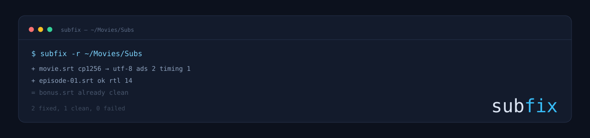

<p align="center">
  
</p>

# subfix

Arabic `.srt` files arrive broken in a few predictable ways. This fixes the ones it can
prove, and refuses to guess at the rest.

Before:

```srt
3
00:00:07.000 --> 00:00:06.200
السلام عليكم
```

After:

```srt
3
00:00:07,000 --> 00:00:08,500
السلام عليكم
```

## Install

Python 3.9 or newer, nothing else:

```bash
git clone https://github.com/hfip/subfix.git
cd subfix
pipx install .
```

It is not on PyPI yet, so plain `pipx install subfix` will not work.

## Use

```bash
subfix movie.srt
subfix -r ~/Movies/Subs            # whole folder
subfix -n -r ~/Movies/Subs         # report only
subfix --check -r .                # exit 1 if anything needs fixing
subfix --shift +1.2s movie.srt     # audio drifted
```

```
  + movie.srt  2 cues · cp1256 -> utf-8 · ads 2 · timing 1 · rtl 1 · empty 2

SubFix 0.1.1  ·  1 fixed, 0 clean, 0 failed
backups written as *.srt.bak
```

## What it changes

- **Encoding.** cp1256, ISO-8859-6, UTF-16 and BOMs are decoded and written back as UTF-8.
- **Double decoding.** Both `السلام` (latin-1) and `ط§ظ„ط³ظ„ط§ظ…` (cp1256) are detected
  and reversed, then checked against the original by an Arabic-character ratio.
- **Timing.** Out-of-range fields are clamped, `.` becomes `,`, an end before its start is
  pushed out, and anything shorter than 700 ms is stretched. Milliseconds longer than
  three digits still parse.
- **Order.** Cues are sorted by start time and renumbered from 1.
- **Direction.** Stray LRM/RLM/RLE characters are removed. A line that starts with Latin
  but contains Arabic gets a leading RLM so the paragraph direction is right-to-left.
- **Watermarks.** URLs, `@handles` and social brands are removed anywhere; weak signals
  like `ترجمة:` are only removed in the first and last three cues.
- **Empty cues.** Blocks with no text left after cleanup are dropped, unless that would
  empty the whole file.

## What it refuses to do

The failure mode that matters with subtitle tools is silent data loss, so the parser is
strict about it:

- If a block contains an arrow (`-->` or a mistyped `->`) but cannot be parsed, the whole
  run aborts. The file is left exactly as it was and the approximate line is reported.
- If cleanup would remove every cue, nothing is written.
- `.ass`, `.ssa` and `.vtt` are not supported. Only SRT is read, and a WebVTT file is
  reported as "no SRT cues found" rather than mangled.

## Flags

| Flag | What it does |
| --- | --- |
| `-r, --recursive` | walk into subdirectories |
| `-n, --dry-run` | report, write nothing |
| `-c, --check` | exit `1` when a file needs fixing, write nothing |
| `--shift SPEC` | shift all timings: `+1.5s`, `-800ms`, `00:00:02,500` |
| `--no-ads` | keep watermark and credit lines |
| `--no-bidi` | keep invisible bidi characters |
| `--no-rtl` | do not add RLM to mixed lines |
| `--no-backup` | skip `.srt.bak` files |
| `--json` | machine-readable report |
| `-q, --quiet` | issues only, no summary |

Exit codes: `0` success, `1` needs fixing (`--check` only), `2` error.

## Backups

Every file that changes gets a `movie.srt.bak` next to it, overwritten on each run rather
than accumulating. `--no-backup` exists for people who keep subtitles in git. There is no
network code in the package; nothing leaves the machine.

## بالعربي

<div dir="rtl" align="right">

ملفات الترجمة العربية تجيك مكسّرة بنفس الطرق تقريباً كل مرة: ترميز قديم، أو نص انحفظ
مرتين فطلع `السلام`، أو توقيتات خربانة، أو سطر دعائي ملصوق فوق الحوار.

`subfix` يصلّح اللي يقدر يثبته، ويرفض يخمّن:

```bash
subfix -r ~/Movies/Subs
```

نقطة مهمة: إذا لقى مقطع ما يقدر يقرأه، يوقف ولا يكتب شي — أفضل من ملف ناقص ما تدري عنه.
ويحفظ نسخة `.bak` قبل أي تعديل.

</div>

## License

MIT. See [LICENSE](LICENSE).
